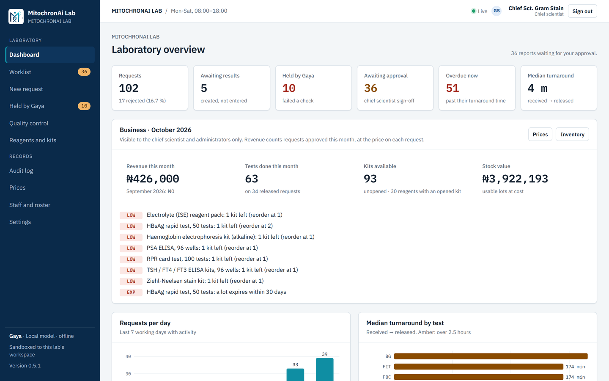
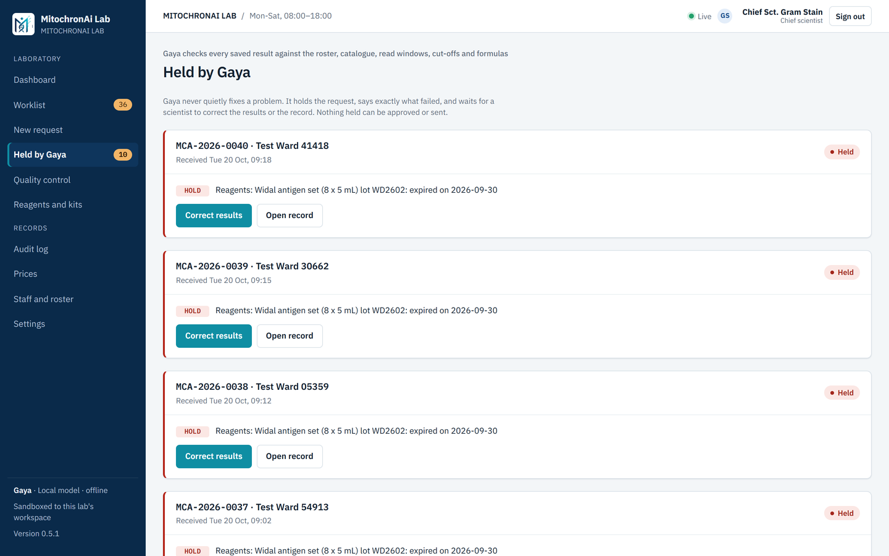

# MitochronAi Lab

[](https://github.com/LordDamian7/mitochronai-lab/actions/workflows/tests.yml)

**An offline-first laboratory system for diagnostic labs, with an AI assistant, Gaya, built by a medical laboratory scientist.**

Gaya takes the administrative load off scientists: it checks every result against the lab's rules, drafts reports on the lab's letterhead and holds anything doubtful for a person. Gaya does not interpret results. A named chief scientist approves everything before release, and every action is logged.

> **Status: v0.5.1, working prototype.** Runs on a Windows lab PC and serves the lab's network. All data in this repository is synthetic. Not yet used in a live laboratory.



## Where it comes from
Gaya was first piloted as a Claude Project running a simulated laboratory with test records. In that pilot it caught four errors before they reached a report: a Mantoux reading recorded before its read window, the wrong tuberculin cut-off, an LDL value that didn't match the Friedewald formula, and a test attributed to a scientist who wasn't on duty. This repository rebuilds that work as software, so those checks are **deterministic, tested code** rather than something a model has to remember.

## What works today
| Area | Highlights |
|---|---|
| Requests and results | Patient registration; multi-test requests from a 248-entry catalogue; plausibility guards on entry; calculated values (e.g. Friedewald LDL) filled in by the server |
| Gaya's checks | Duty roster, Mantoux read window and risk-based cut-off, reference-range and critical flags, expired reagent lots. Failing requests are **held with the reason shown**, never quietly fixed |
| Critical results | Approval is blocked until a phone call is recorded with read-back (ISO 15189:2022-style notification) |
| Approval and reports | The chief scientist must open the preview before "Approve and send"; changed results withdraw the old draft |
| Quality control | Levey-Jennings charts and Westgard multirules (1-2s, 1-3s, 2-2s, R-4s, 4-1s, 10x) |
| Reagents | Lots, deliveries in quarantine until verified, new-lot verification, expiry tracking |
| Administration | Roles (scientist, chief scientist, admin), staff and duty roster, searchable audit log with CSV export |
| Offline updates | Ed25519-signed update packages installed from a USB stick; database backup, rebuild, self-test and **automatic rollback**; refuses to start on a nearly full disk |



## Security
- Passwords follow NIST SP 800-63B (15–128 characters, common passwords refused); lock-out after 5 failures; 30-minute idle sessions; session tokens stored only as hashes.
- Least privilege enforced on the server: scientists can't see prices, stock costs, staff or the audit log, even by typing the address.
- Security headers against clickjacking; CSV export neutralises spreadsheet formulas.
- Two written reviews with every finding fixed or tracked: [`docs/security/`](docs/security/).

See [SECURITY.md](SECURITY.md) for the data rules and how to report a vulnerability.

## Tech
Next.js 15 (server components and server actions) · TypeScript · Node's built-in `node:sqlite` · `node:test` unit tests · Playwright end-to-end tests in Chrome · Python for the synthetic dataset and its integrity checks. No external services are needed at run time.

## Run it
Needs Node.js 24 or later on Windows, macOS or Linux.
```bash
cd web
npm ci
npm run build
node scripts/run.mjs          # http://127.0.0.1:3000 (this PC only)
```
On Windows, double-click `START-HERE.bat` (this PC only) or `START-LAN.bat` (phones and PCs on the same network). Demo sign-ins are in `web/seed/demo-users.json`; they are for the synthetic demo lab only.

## Tests
```bash
cd web
npm test                      # unit tests
npm run typecheck
node scripts/e2e.mjs          # end-to-end workflow in Chrome (server running on :3000)
python scripts/validate_data.py && python -m unittest discover -s tests   # synthetic dataset (from the repo root)
```
GitHub Actions runs the dataset checks, the unit tests and the type check on every pull request.

## Repository layout
| Path | What it is |
|---|---|
| `web/` | The lab web app: pages in `app/`, domain logic in `lib/` (no framework imports, unit-tested), launcher and update supervisor in `scripts/` |
| `db/schema.sql` | Multi-lab PostgreSQL schema with row-level security (for the planned hosted version) |
| `data/synthetic/`, `scripts/*.py`, `tests/` | Deterministic synthetic dataset and its integrity checks |
| `docs/` | Architecture, implementation plans and security reviews |

## Roadmap
v0.1 data foundation → v0.4 lab web app → **v0.5 offline updates (current)** → SOP library with cited answers → local language model for drafting → report delivery by e-mail/SMS → analyser connection (ASTM/HL7) → two-step sign-in and HTTPS on the lab network → v1.0 in pilot labs. Details in [`docs/ARCHITECTURE.md`](docs/ARCHITECTURE.md).

## About the data
**Everything here is fictional.** The lab, its scientists and its patients are invented, and patient e-mails use the reserved `example.com` domain. Reference ranges follow recognised sources (WHO, NCEP ATP III) or are marked lab-validated. They are for demonstration only and are **not clinical guidance**.

## How it was built
Designed and directed by a medical laboratory scientist, written with AI pair-programming (Claude Code). Every change goes through tests, and security-sensitive changes through a written review.

## Licence
Copyright © 2026 Obialo John Kelechi. All rights reserved; see [LICENSE](LICENSE). The code is published for review, not for reuse.
